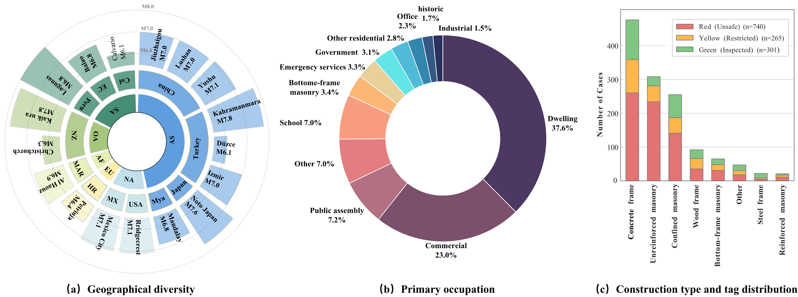

# SeisMLLM-1K: A Multimodal Dataset for Post-Earthquake Building Safety Evaluation

**[Project Page](https://mayixuan836.github.io/SeisMLLM-1K-Dataset/)** · **[Paper](https://doi.org/10.1016/j.aei.2026.105126)** · **[Code](https://github.com/MAYIXUAN836/SeisMLLM)**

**SeisMLLM-1K** is a specialized multimodal dataset designed for training Large Vision-Language Models (LVLMs) to perform professional structural safety assessments of buildings damaged by earthquakes. 

The dataset follows the **ATC-20** and **ATC-20-1** (Applied Technology Council) standards. It pairs multi-view images of damaged buildings with detailed, structured engineering assessmemts.

## 📂 Repository Structure

```
├── SeisMLLM-1K/            # Image directory containing case folders (e.g., case_0001/)
├── train.json              # Training set in ShareGPT format
├── test.json               # Test set
├── Full_GT.json            # Complete ground truth annotation
├── dataset_info.json       # Loader registration for the canonical train/test exports
├── case_study/             # Separate Nepal/Ecuador supplement and citations
├── DATA_DICTIONARY.md      # Released field definitions
├── LICENSE
└── README.md
```

## 📊 Dataset Statistics



- **Total Cases**: `1,306` building-case records with `3,421` referenced image files in the current public release.
- **Domain**: Computer vision, Rapid post-earthquake assessment for buildings, Structural Health Monitoring, MLLM.
- **Images**: Photos from real earthquake sites report (e.g., Jiuzhaigou, etc.).

The current public release covers 1,306 building cases across 17 event groups. Its `train.json` contains 1,241 cases and 3,213 image references; `test.json` contains 65 cases and 208 image references. Their image sets do not overlap, and together reference all 3,421 image files in `SeisMLLM-1K/`. These are counts of the released files. The paper reports 3,856 images and a 9:1 experimental split; the current public export has a different split, and the historical image-count discrepancy is still being reconciled. Validation subsets and similar-case retrieval copies must not be added again when they reuse these cases. The separate Nepal/Ecuador case study is provided as a [supplement](case_study/README.md), with 48 cases and 382 selected image references; it is not part of the core counts or train/test split.

## 📝 Data Format

The dataset uses the standard JSON format compatible with training frameworks like **LLaVA**, **Qwen-VL**, etc.

### Example Entry

```json
{
  "messages": [
    {
      "role": "user",
      "content": "<image><image>... Earthquake Metadata: Name: Jiuzhaigou Earthquake...\nTask: Act as a structural engineer. Analyze the provided images and generate a Stage 1: Understanding report..."
    },
    {
      "role": "assistant",
      "content": "### Stage 1: Understanding\n[IS]: Exterior and interior\n[PO]: Evidence: ...; Category: Commercial\n[CT]: Evidence: ...; Category: Confined masonry\n[SN]: Over ground: 3\n[DC]: collapse: Severe (...); building: Severe (...); ...\n[SID]:\n- E1_C001_I01.jpg: Exterior view..."
    }
  ],
  "images": [
    "Dataset/SeisMLLM-1K/case_0001/E1_C001_I01.jpg",
    "Dataset/SeisMLLM-1K/case_0001/E1_C001_I02.jpg"
  ]
}
```

## 🏷️ Annotation Schema

The current `train.json` and `test.json` exports contain the following report fields. For the complete record schema, see [DATA_DICTIONARY.md](DATA_DICTIONARY.md).

| Field | Full Name | Description |
| :--- | :--- | :--- |
| **[IS]** | Image Scope | Viewpoints covered (e.g., Exterior, Interior, Detail). |
| **[PO]** | Primary Occupation | Usage category (e.g., Residential, Commercial, School). |
| **[CT]** | Construction Type | Structural system (e.g., Confined Masonry, RC Frame). |
| **[SN]** | Stories Number | Count of stories over/under ground. |
| **[DC]** | Damage Conditions | Six hazard ratings and their supporting descriptions, derived from `Full_GT.json` → `6_evaluation`. |
| **[SID]** | Single Image Description | Available image-level descriptions. |

### Which files define this release?

- `Full_GT.json` contains the complete released case annotations, including six condition ratings (`6_evaluation`) and the Green/Yellow/Red posting and reasoning (`8_final_status`). Its schema is documented in [DATA_DICTIONARY.md](DATA_DICTIONARY.md).
- `train.json` and `test.json` are conversation exports. `[DC]` contains the six damage-condition ratings and supporting descriptions. Safety postings and reasoning are available in `Full_GT.json`, rather than a dedicated output field in these exports.
- `dataset_info.json` registers the two files actually shipped here. The earlier `classification_*`, `description_*`, `_v2` and `_linux_fixed` registrations were internal training/export configurations, not additional public dataset versions.

**Image paths.** Remove the leading `Dataset/` when resolving paths relative to this repository. All 3,421 `Full_GT.json` image references and all conversation input image paths resolve to the released files. The legacy annotation `case_id` can differ from the current image-folder ID; use image paths or complete image filenames to associate records. There are still 64 image-description entries for unreleased filenames, and some unmatched captions also occur in the conversation exports' `[SID]` sections. For image-level caption tasks, retain only captions matching the same case's input images. See the [field dictionary](DATA_DICTIONARY.md#image-paths-and-caption-coverage) for details.

## Separate case-study supplement

The [Nepal/Ecuador supplement](case_study/README.md) includes case-level annotations, inference inputs without answers, a per-image source/filename/rights manifest, and original-data citations. Original-resolution images are available through the linked release archives. The authors’ original contributions use the scoped CC BY-NC 4.0 notice; these two sources’ photographs and source materials retain their original **CC BY-SA 3.0** license. See the supplement’s [LICENSE](case_study/LICENSE) and [citations](case_study/CITATIONS.bib).

## 🚀 Usage

This dataset is ready for **Supervised Fine-Tuning (SFT)** of Multimodal LLMs.

1. **Clone the repository**:
   ```bash
   git clone https://github.com/MAYIXUAN836/SeisMLLM-1K-Dataset.git
   cd SeisMLLM-1K-Dataset
   ```

2. **Load Data (Python)**:
   ```python
   import json
   
   with open('train.json', 'r') as f:
       data = json.load(f)
       
   print(f"Loaded {len(data)} training samples.")
   ```

3. **Training**:
   Ensure your training framework supports Multi-image inputs if you plan to use all images per case. The `images` field contains relative paths to the `SeisMLLM-1K` directory.

## ⚠️ License & Disclaimer

The SeisMLLM authors’ original annotation contributions and original documentation are licensed under **[CC BY-NC 4.0](https://creativecommons.org/licenses/by-nc/4.0/)**, to the extent the authors hold the rights to license them. See [LICENSE](LICENSE) for the scope and the link to the complete license terms.

For those licensed contributions, noncommercial research use, derivative annotations and publication of aggregate research results are permitted subject to the license, including attribution and identification of changes. This permission is not a blanket license for third-party photographs, inspection reports, atlas excerpts or other source material. Those materials retain their original rights and applicable terms; users must obtain any additional permissions needed for their intended use. No single image license has been verified for the entire collection. The paper’s publication license does not automatically license the dataset.

This dataset is intended as a research resource. Its annotations and model outputs do not replace an on-site safety evaluation by qualified professionals.

## 📚 Data Sources & Acknowledgements

Images and contextual records were collected from earthquake reconnaissance reports, earthquake atlases and public cyberinfrastructures. These source materials should be distinguished from the structured labels created for SeisMLLM-1K.

As described in Section 3.1.1 of the [paper](https://doi.org/10.1016/j.aei.2026.105126), annotation was model-assisted: initial structured drafts used multi-view images, event metadata and expert field notes, with three expert-verified anchor cases. The paper reports manual checking by two annotators with structural and earthquake engineering backgrounds and third-reviewer adjudication for ambiguous or conflicting cases. The released labels should therefore be described as **model-assisted annotations with human verification, informed by reconnaissance materials**, rather than as a verbatim release of official inspection labels or wholly independent expert-only annotations. Individual JSON records do not include reviewer identities, item-level review histories or a generation-model identifier.

We gratefully acknowledge the following sources:

### Primary Data Sources
- **China Earthquake Damage Records**: Images and structural descriptions for the Jiuzhaigou, Yushu, and Lushan earthquakes are sourced from the following authoritative records:
  - *Dai et al. (2018):* Engineering Seismic Damage of Jiuzhaigou Ms 7.0 Earthquake.
  - *Sun et al. (2016):* Seismic Damage of Yushu Ms 7.1 Earthquake.
  - *Sun et al. (2014):* Atlas of Building Seismic Damage from the Lushan "4.20" Ms 7.0 Earthquake.
- **DesignSafe-CI & StEER**: A portion of the data is collected from the [DesignSafe](https://www.designsafe-ci.org/) cyberinfrastructure, specifically contributed by the **Structural Extreme Events Reconnaissance (StEER)** network.

### BibTeX Reference
If you use this dataset or the SeisMLLM framework in your research, please cite our work ([CITATION.bib](CITATION.bib)) and the original data sources. The separate supplement also provides [source-specific citations](case_study/CITATIONS.bib):

```latex
@article{ma2026seismllm,
  title = {A dual-retrieval augmented Multimodal Large Language Model
           framework for automatic post-earthquake building safety evaluation},
  author = {Ma, Yixuan and Jiang, Jun and Wang, Shuo and Liu, Jiahui
            and Qi, Xiaojuan and Wang, Xuguang},
  journal = {Advanced Engineering Informatics},
  volume = {76},
  pages = {105126},
  year = {2026},
  doi = {10.1016/j.aei.2026.105126},
  url = {https://doi.org/10.1016/j.aei.2026.105126}
}

@article{sun2014lushan,
  title={Atlas of Building Seismic Damage from the Lushan "4.20" Ms 7.0 Strong Earthquake in Sichuan (in Chinese)},
  author={Sun, Baitao and Yan, Peilei and Wang, Mingzhen and Zhang, Haoyu and Chen, Xiangzhao},
  year={2014},
  publisher={Seismological Press}
}

@article{sun2016yushu,
  title={Seismic Damage of Yushu Ms 7.1 Earthquake in Qinghai (in Chinese)},
  author={Sun, Jingjiang and Li, Shanyou and Dai, Junwu and Gong, Maosheng},
  year={2016},
  publisher={Seismological Press}
}

@article{dai2018jiuzhaigou,
  title={Engineering Seismic Damage of Jiuzhaigou Ms 7.0 Earthquake in Sichuan (in Chinese)},
  author={Dai, Junwu and Sun, Baitao and Xiong, Lihong and Tao, Zhengru and Ma, Qiang and Lin, Junqi},
  year={2018},
  publisher={Seismological Press}
}

@article{rathje2017designsafe,
  title={DesignSafe: A new cyberinfrastructure for natural hazards engineering},
  author={Rathje, Ellen M and others},
  journal={Natural Hazards Review},
  year={2017}
}

@article{kijewski2019structural,
  title={Structural extreme events reconnaissance (StEER) network: A new model for post-disaster data collection},
  author={Kijewski-Correa, Tracy and others},
  journal={Frontiers in Built Environment},
  year={2019}
}

```

---
*Created for the SeisMLLM Project.*
